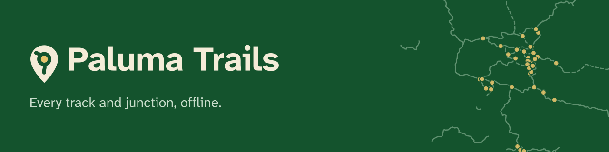
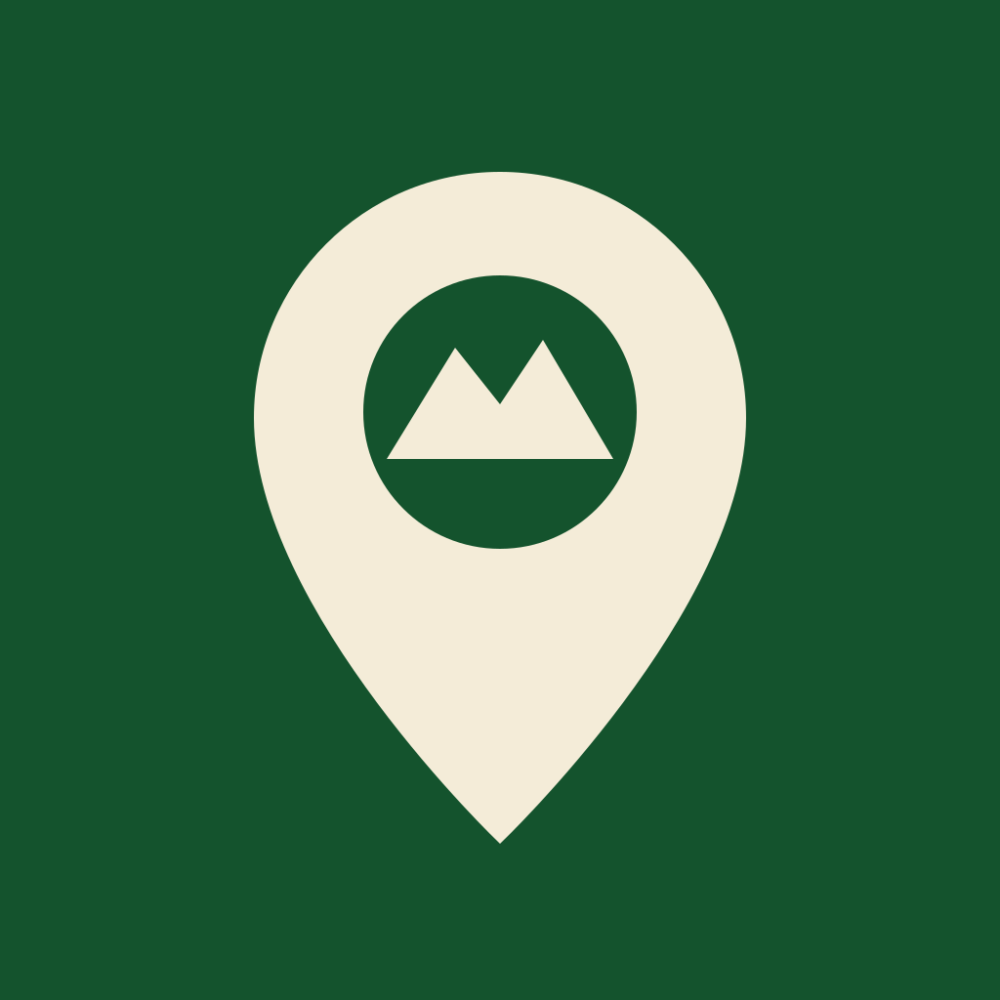
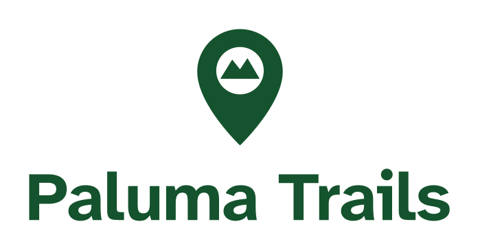

# Branding

- **Status:** living document; identity complete
- **Last reviewed:** 2026-10-23
- **Decisions:** #88 (foundation), #90 (wordmark, tagline, typeface, map
  palette, small mark, surfaces)

This is the reference for the app, web build, icons, splash screens, store
listing and project pages. Update it in the same pull request as any visual or
voice change. Generation commands live in
[`tools/brand/README.md`](../tools/brand/README.md),
[`app/assets/icon/README.md`](../app/assets/icon/README.md) and
[`docs/store/README.md`](store/README.md); this file explains what to use and
why.



## In one line

Paluma Trails is a calm, offline-first trail companion for Paluma Range
National Park: useful before the walk, dependable on the track, and honest
about what is estimated or unverified.

## Personality

- **Calm.** The map is the interface. Avoid noisy decoration, gradients and
  motion for its own sake.
- **Local.** Paluma is the subject, not a generic “adventure” brand. Use real
  place names, real tracks and the park's own language.
- **Practical.** A walker may be hot, tired, in poor light or out of mobile
  reception. Clarity beats cleverness.
- **Safety-conscious.** Say when something is an estimate, unverified or
  offline. Never make a hazard or emergency message look playful.
- **Honest.** No fake precision, no “guaranteed” times, no implying that the
  app replaces official park advice.

Avoid: hype, gear-catalogue language, theme-park styling, emoji in safety copy,
and unexplained acronyms.

## Name, tagline and voice

- The product name is **Paluma Trails** (two words, title case), on every
  platform and in every listing. It is not shortened to “Paluma”: that is the
  village and the range, and the product should not claim it.
- Use **Paluma Range National Park** on first mention in public copy.
- `Paluma-Trails` is only the repository/service slug.

| Line | Text | Where |
| --- | --- | --- |
| Tagline | **Every track and junction, offline.** | Loading screen, About header, README, store short description, feature graphic, social preview |
| Descriptor | Offline trail map for Paluma Range National Park | Web `<meta name="description">`, PWA manifest, `pubspec.yaml` |
| Eyebrow | PALUMA RANGE NATIONAL PARK · QUEENSLAND | Feature graphic and social preview only |

The tagline says what the app does and the one thing that makes it different,
without promising anything the app cannot keep. It replaces “Offline trail map ·
Queensland”, which is now split between the descriptor and the eyebrow. The
app bar does not carry a tagline: it carries the park name, and the map does
the rest.

Voice rules:

- Sentence case for headings, buttons and labels. Title case only for proper
  names.
- Plain English, active voice, short sentences.
- Quantities always carry units: `2.4 km`, `45 min`, `±8 m`.
- Walking times are estimates. Write “Estimated 45 min”, not “45 min”.
- Say what works offline and what does not. “Fetched at” is part of the
  interface, not a disclaimer hidden in settings.
- Avoid exclamation marks, “just”, “simply” and blame. Errors explain the next
  action.

| Situation | Prefer | Avoid |
| --- | --- | --- |
| Walking time | Estimated 45 min | 45 min |
| No reception | Offline map ready · bundle 2026.10 | No signal |
| Unchecked content | Unverified | Accurate / official |
| Recoverable error | The offline map could not open. Try again. | Error 42 |

## Logo

The identity has two parts: the **junction pin** and the **wordmark**. Both
are original to the project.

### Junction pin

A map pin whose hole is a **junction ring**, the same idea as the numbered
junction markers on the map, with one trail leaving it towards the tip and a
branch leaving it to the upper left. It says what the app is for: knowing which
junction you are at and where the tracks go from it. The ring and its stem
also echo a “P”, for Paluma.



- The ring and trails are **cut out**, not painted, so the mark works in one
  colour on any field.
- In full colour the disc inside the ring is **sand**. Use the sand junction
  only on rainforest (the icon, splash, app bar, loading screen, About header,
  reversed lockups and marketing art). On light fields the disc is the mark's
  own colour.
- It is **one mark at every size**. The cuts are thick enough (a tenth of the
  pin's height) to survive the 16 px favicon, so there is no separate
  small-size drawing.
- The geometry lives in `tools/brand/build_brand.py`, which writes every icon
  source, and is mirrored by `TrailPinMark` (`app/lib/src/brand/brand.dart`).
  Change both together.

It replaced the original pin-with-mountain mark in #90. A pin and mountain is
the stock symbol of hiking and map apps, said nothing about junctions, and its
mountain was unreadable below 28 px.

### Wordmark

“Paluma Trails” set in **Atkinson Hyperlegible Next Bold** at −1.5% tracking,
outlined to vector paths so it never depends on an installed font. It is the
same typeface the app uses, so the wordmark and the interface read as one
voice.

### Lockups

Generated by [`tools/brand/build_brand.py`](../tools/brand/build_brand.py) into
[`docs/brand/`](brand/); do not edit the SVGs by hand. Each file already
includes its clear space.

| Lockup | Use | Files |
| --- | --- | --- |
| Horizontal | Default: headers, README, web, About screen | `lockup-horizontal{,-reversed,-black,-white}.svg` |
| Stacked | Square or narrow spaces: splash-style layouts, posters, social avatars with room | `lockup-stacked{,-reversed,-black,-white}.svg` |
| Wordmark only | Where the pin is already present nearby | `wordmark{,-reversed,-black,-white}.svg` |

<table>
  <tr>
    <td bgcolor="#F4ECD8"></td>
    <td bgcolor="#14532D"></td>
  </tr>
  <tr>
    <td bgcolor="#F4ECD8" align="center"></td>
    <td bgcolor="#14532D" align="center"></td>
  </tr>
</table>

| Colourway | Mark and wordmark | Field |
| --- | --- | --- |
| Primary (no suffix) | Rainforest `#14532D` | Cream, white or a light photo area |
| `-reversed` | Cream `#F4ECD8` | Rainforest (the default brand field) |
| `-black` | Black | Single-colour print, light fields |
| `-white` | White | Single-colour print, dark fields and photos |

In the app, `BrandLockup`, `Wordmark` and `TrailPinMark`
(`app/lib/src/brand/brand.dart`) draw the same geometry and the same type
live, so they scale with the screen and need no SVG dependency.

### Clear space and minimum size

- **Clear space:** at least 0.25× the pin's height on every side. The app-icon
  tile is the exception: the mark is already composed for the tile.
- **Horizontal lockup:** at least 120 px (screen) or 30 mm (print) wide.
- **Stacked lockup:** at least 72 px or 18 mm wide.
- **Junction pin:** at least 16 px tall. Checked at 16 px (favicon), 24 px,
  30 px (app bar), 48 px (launcher) and 512 px (store).

| Size | Where | Notes |
| --- | --- | --- |
| 16–32 px | Browser tab (`app/web/favicon.svg`) | The pin is enlarged in a rounded tile |
| 30 px | App bar | Cream with the sand junction |
| 48 px and up | Launcher, store, splash | Generated from the icon sources |

### Do not

Rotate, stretch, crop, outline, add gradients or shadows, re-typeset the
wordmark in another font, change its tracking, place the cream mark on sand or
white, put sand on a light field, put text inside the app icon, change the
number or direction of the trails, or fill the ring instead of cutting it.

## Colour

### Brand palette

| Token | Hex | Use | Contrast |
| --- | --- | --- | --- |
| Rainforest | `#14532D` | Brand field: icon tile, splash, app bar, loading screen, About header, marketing | — |
| Trail green | `#2E6B4F` | Flutter theme seed; primary actions through `ColorScheme` | — |
| Cream | `#F4ECD8` | Mark, wordmark and text on rainforest | 7.7:1 on rainforest |
| Sand | `#E9C46A` | Short accent rules and progress on rainforest; never body text on light surfaces | 5.5:1 on rainforest |
| Mist | `#9CC3A6` | Secondary text on rainforest (region, eyebrow) | 4.7:1 on rainforest |
| Pale mist | `#C9DDCB` | Tagline and supporting text on rainforest | 6.4:1 on rainforest |

All brand pairs meet WCAG AA for normal text; `tools/brand/colour_check.py`
checks them. In Flutter they live in `BrandColors`
(`app/lib/src/brand/brand.dart`).

The app theme (`buildPalumaTheme` in `app/lib/src/brand/theme.dart`) is
Material 3, seeded from **Trail green**:

```dart
ColorScheme.fromSeed(
  seedColor: BrandColors.trailGreen,
  brightness: brightness,
  contrastLevel: sunlight ? 1.0 : 0.0,
)
```

On top of the generated scheme, the theme sets the bundled typeface, bold
headings and a **rainforest app bar with cream title and icons** in every mode.
That bar is the same field as the icon and the splash, so launch → loading →
map reads as one surface.

Use the generated `colorScheme` roles (`primary`, `onPrimary`, `surface`,
`onSurface`, `error`, `errorContainer`, …) in widgets. Brand colours are used
directly only on rainforest surfaces (loading screen, About header) through
`BrandColors`; the white sunlight scaffold is the only other fixed colour.

### Map palette

Map colours are data encodings, not brand accents. Do not reuse them for
buttons or status. They may be reused for a key or badge that stands for a map
feature (the map key, junction badges and track swatches in the sheets), so the
sheet and the map are easy to match up.

| Feature | Light mode | Sunlight mode | Non-colour cue |
| --- | --- | --- | --- |
| Basemap background | `#CCCCCC` | unchanged (light basemap) | — |
| Earth | `#E2DFDA` | unchanged | — |
| National park / forest | `#9CD3B4` | unchanged | — |
| Walking track, short walk | `#2E7D32`, solid | same, heavier | Solid line; sheet names the class |
| Informal / unclassified track | `#2E7D32`, dashed 2 : 1.5 | same, heavier | Dashed |
| MTB track | `#8E24AA` | same, heavier | Sheet names the class |
| Road | `#455A64` | same, heavier | Sheet names the class |
| Connector | `#5D4037` | same, heavier | Sheet names the class |
| Track casing | `#0B3D2E` at 35% | at 60%, heavier | — |
| Junction | `#FFF8E1` fill, `#BF360C` ring, `#3E2723` number | `#FFFFFF` / `#000000` / `#000000` | Numbered circle |
| POI | `#01579B` dot, white ring; label `#0D47A1` | `#0D47A1` dot; label `#000000` | Labelled dot |

The values live in `MapPalette` (`app/lib/src/map/map_palette.dart`); the map
layers, the map key and the sheet badges all read from it. Sunlight mode also
increases line widths, label sizes and text halos.

#### Colour-vision and contrast review (#90)

`python tools/brand/colour_check.py` reads `MapPalette` and fails if a check
regresses. CI runs it.

- **Contrast with the basemap.** Every line and marker colour now has at least
  3:1 against the park, wood and earth fills (WCAG 1.4.11). Before this review
  road (2.6:1), connector (2.7:1) and POI (2.8:1) fell short on the park fill;
  they were darkened.
- **Colour vision.** Under simulated deuteranopia, protanopia and tritanopia
  (Machado et al. 2009, full severity) the four line colours now stay at least
  13 CIEDE2000 apart, and the two marker colours at least 46 apart. Before, the
  closest pairs were walking track and road under tritanopia (9.8) and walking
  track and connector under deuteranopia (10.5). MTB moved from `#6A1B9A` to
  `#8E24AA` so it stays clear of the darker road.
- **Not colour alone.** Informal tracks are dashed; junctions are numbered
  circles; POIs are labelled. Every sheet names the track class in words, the
  track sheet shows a line sample next to the class name, and the display
  sheet (the tune button) carries a **map key** that pairs every symbol with
  words.

### Dark basemap: ruled out

Dark mode keeps the **light basemap** inside the dark app shell, deliberately:

- Paluma's tracks are walked in daylight. A dark map would mostly be seen in
  the situations sunlight mode exists for, where it is the wrong choice.
- One basemap means one map palette to keep colourblind-safe and above 3:1; a
  second palette would double that review for little gain.
- The light map is the paper-map analogue walkers already carry, and it
  matches the store screenshots and printed park maps.

Revisit only if night use becomes a real need (for example camping or
spotlighting walks); that would need its own palette review.

### Contrast and modes

- Body text and icons must meet WCAG AA: **4.5:1** for normal text, **3:1** for
  large text and non-text UI.
- Prefer `on*` roles from the generated scheme over hand-picked pairs.
- Sand is an accent, not a text colour on cream or white.
- Sunlight mode is not a separate brand. It is the same palette with stronger
  contrast, a white scaffold and heavier map strokes. Test it outdoors, not just
  in a simulator.

## Typography

**Decision (#90): bundle Atkinson Hyperlegible Next for the interface.**

| | |
| --- | --- |
| Typeface | Atkinson Hyperlegible Next, by the Braille Institute of America |
| Licence | SIL Open Font License 1.1 (`app/assets/fonts/atkinson_hyperlegible_next/OFL.txt`, also on the app's licence page) |
| Weights bundled | Regular 400, Medium 500, Bold 700 (about 200 KB in total) |
| Offline | Bundled as a Flutter font asset on Android, iOS and web; nothing is fetched |
| Fallback stack | Platform sans: Roboto (Android), San Francisco (iOS), the browser sans (web) |

Why this face: it was designed for low-vision readers, so letterforms that are
easily confused stay distinct — `Il1`, `O0` (slashed zero), `rn`/`m`. Those are
exactly the characters in junction numbers, distances and times, read on a
small screen in glare. The weight is sturdy enough for the wordmark too, which
keeps the identity to one family.

Rules:

- Use `Theme.of(context).textTheme`; the theme already sets the family. Do not
  hard-code font sizes or families in widgets (the brand widgets are the
  exception).
- Headings (`headline*`, `titleLarge`) are bold, like trail signage; body and
  labels keep the Material weights.
- Sentence case; avoid long all-caps strings except a short eyebrow such as
  `PALUMA RANGE NATIONAL PARK`.
- **Map labels stay Noto Sans** (`Noto-Sans-Medium` and friends, via the
  basemap glyph PBFs). Changing them means regenerating the glyphs and checking
  the offline bundle size; there is no legibility problem worth that today.
- Marketing artwork outlines all text, so it renders the same everywhere.

## Layout and components

- **Map first.** The park map fills the screen. The rainforest app bar carries
  the junction pin, the park name and the About action; detail appears in
  bottom sheets, not permanent side panels.
- **Controls:** round 48×48 controls with 26 px icons, bottom-right, so they are
  reachable with a thumb or a glove. Keep essential controls visible; do not
  hide them behind a long-press or gesture.
- **Surfaces over the map:** use the theme surface at 0.8–0.9 opacity for the
  location card and the offline chip. Radii are 10 for cards and 8 for the
  offline chip; keep new components close to that scale.
- **Brand surfaces:** the loading screen and the About header sit on rainforest
  with the cream mark, the wordmark, the pale-mist tagline and a short sand
  rule. Use rainforest for these identity moments only, not behind content.
- **Spacing:** use a 4 px base—4, 8, 12, 16, 24, 32. The bottom sheets use a
  drag handle, `SafeArea` and a maximum height of 70% of the screen.
- **Elevation:** Material 3 defaults. Do not add decorative shadows or glass
  effects.
- **Iconography:** Material icons, outlined for actions and status. A custom
  icon set is not worth the maintenance unless a symbol is genuinely missing.
- **Motion:** short, functional transitions only. Respect reduced-motion
  settings where Flutter exposes them. No looping decorative animation.

## Accessibility and outdoor use

- 48 dp minimum touch targets; check text scaling and large-text layouts.
- Keep map labels and controls readable in sunlight; sunlight mode must remain
  usable with sunglasses and a scratched screen.
- Do not encode track class or status by colour alone (see the map palette
  review above).
- Location accuracy is approximate: show `±N m` when known and never present a
  GPS fix as exact.
- Offline state is part of the interface. The “Offline map ready · bundle …”
  chip stays visible on the map.
- Emergency, hazard and safety copy uses the error container styling and plain
  language. It is never hidden in a decorative card.

## Imagery

- Prefer original diagrams, SVG artwork and real screenshots of the app.
- The marketing background is the park's real track network and junctions,
  drawn from `content/data/`. Do not substitute invented contours or a stock
  map: the artwork should be as honest as the app.
- Photographs need a recorded licence and attribution; see #28 before adding
  historic or third-party images.
- Do not present AI-generated images as historic photographs or official park
  imagery.
- Store screenshots must show real content, not mocked data. The current
  screenshots use a simulated GPS fix with real junction distances; see
  `docs/store/README.md`.

## Asset inventory and workflow

| Asset | Source | Output |
| --- | --- | --- |
| App icon | `app/assets/icon/icon.svg` (generated) | Android legacy/adaptive/monochrome, iOS, web PWA icons |
| Adaptive foreground | `app/assets/icon/icon_foreground.svg` | Android adaptive icon |
| Themed icon | `app/assets/icon/icon_monochrome.svg` | Android 13+ monochrome layer |
| Splash | `app/assets/icon/icon_android12.svg`, `icon_splash.svg` (transparent) | Android 12+, older Android/iOS launch, web loader |
| Favicon | `tools/brand/build_brand.py` | `app/web/favicon.svg` |
| Wordmark and lockups | `tools/brand/build_brand.py` | `docs/brand/*.svg` |
| Feature graphic | `tools/brand/build_brand.py` | `app/assets/icon/feature_graphic.svg` → `docs/store/feature-graphic.png` |
| Social preview | `tools/brand/build_brand.py` | `docs/brand/social-preview.svg` → `.png` (upload in repository settings) |
| README header | `tools/brand/build_brand.py` | `docs/brand/readme-header.svg` |
| Store icon | `app/assets/icon/icon.svg` | `docs/store/icon-512.png` |
| Screenshots | web build at 540×873 CSS px, 2× | `docs/store/screenshots/` |

After changing artwork:

1. Run `python tools/brand/build_brand.py`; it writes every icon source as
   well as the lockups and marketing art.
2. Run `tools/brand/render_png.sh` to render every PNG.
3. Run `cd app && dart run flutter_launcher_icons && dart run flutter_native_splash:create`.
4. Run `cd app && tool/check_generated_icons.sh`; CI runs the same check.
5. Inspect the icon at 16, 24, 48 and 512 px, the Android themed icon, the iOS
   icon and the web favicon.
6. Refresh store screenshots if the UI changed, then update
   `docs/store/README.md` if the inventory changed.

## Brand review checklist

The pull-request template links here. Use it for UI, icon, store and web PRs:

- [ ] Colours come from the theme, `BrandColors` or `MapPalette`; no
      unexplained hex in widgets.
- [ ] Text and icons meet AA contrast; `tools/brand/colour_check.py` passes;
      sunlight mode checked.
- [ ] Touch targets are at least 48 dp and the layout survives large text.
- [ ] The mark and wordmark come from the source artwork or the brand widgets,
      with clear space and no effects.
- [ ] Voice is plain, sentence case, and labels estimates as estimates.
- [ ] Offline and unverified states are still clear.
- [ ] Icons/splash/store outputs were regenerated and the CI drift check passes.
- [ ] Any new asset has a recorded licence or is original to the project.

## Open decisions

None. The items #88 left open were decided in #90:

| Item | Decision |
| --- | --- |
| Wordmark and lockup | Outlined Atkinson Hyperlegible Next Bold; horizontal and stacked lockups in four colourways |
| Tagline | “Every track and junction, offline.” |
| Typeface | Atkinson Hyperlegible Next bundled for the interface; map labels stay Noto Sans |
| Dark basemap | Ruled out; dark mode keeps the light basemap |
| Track-class colours | Reviewed; three colours darkened, informal tracks dashed, map key added |
| Small-size mark | Replaced the pin-and-mountain with the junction pin, which works at every size from 16 px |
| Surfaces | Social preview, README header, feature graphic and four store screenshots generated from the sources |

One step needs a maintainer with admin rights: upload
`docs/brand/social-preview.png` under **Settings → General → Social preview**.

## References

- #90 — finishing the identity (this revision)
- #88 — brand identity review
- #71 — original icon, splash, web icons and store artwork
- #52 — store listing and screenshots
- #28 — image rights and historic photo licensing
- #21 — sunlight mode and outdoor controls
- #53 — accessibility review
- `tools/brand/README.md` — brand artwork generator and checks
- `app/assets/icon/README.md` — icon render and generator commands
- `docs/store/README.md` — store asset inventory
