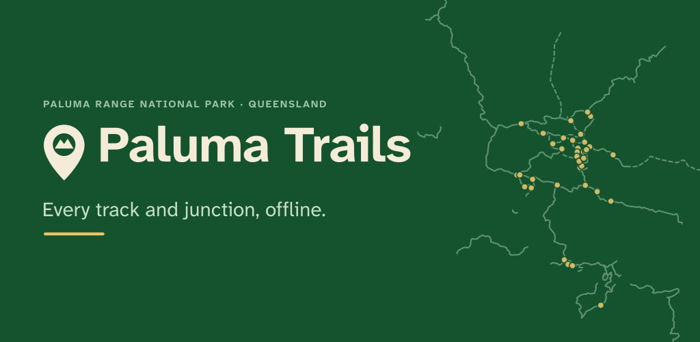

# Branding

- **Status:** living document; current baseline
- **Last reviewed:** 2026-10-22
- **Formal review:** #88

This is the reference for the app, web build, icons, splash screens, store
listing and project pages. Update it in the same pull request as any visual or
voice change. The generation commands stay in
[`app/assets/icon/README.md`](../app/assets/icon/README.md) and
[`docs/store/README.md`](store/README.md); this file explains what to use and
why.

## In one line

Paluma Trails is a calm, offline-first trail companion for Paluma Range
National Park: useful before the walk, dependable on the track, and honest
about what is estimated or unverified.

## Personality

- **Calm.** The map is the interface. Avoid noisy decoration, gradients and
  motion for its own sake.
- **Local.** Paluma is the subject, not a generic “adventure” brand. Use real
  place names, real tracks and the park's own language.
- **Practical.** A walker may be hot, tired, in poor light or out of mobile
  reception. Clarity beats cleverness.
- **Safety-conscious.** Say when something is an estimate, unverified or
  offline. Never make a hazard or emergency message look playful.
- **Honest.** No fake precision, no “guaranteed” times, no implying that the
  app replaces official park advice.

Avoid: hype, gear-catalogue language, theme-park styling, emoji in safety copy,
and unexplained acronyms.

## Name and voice

- The product name is **Paluma Trails** (two words, title case).
- Use **Paluma Range National Park** on first mention in public copy.
- `Paluma-Trails` is only the repository/service slug.
- The current descriptor is **Offline trail map · Queensland**, used in the
  store feature graphic. A shorter primary tagline is still open in #88.

Voice rules:

- Sentence case for headings, buttons and labels. Title case only for proper
  names.
- Plain English, active voice, short sentences.
- Quantities always carry units: `2.4 km`, `45 min`, `±8 m`.
- Walking times are estimates. Write “Estimated 45 min”, not “45 min”.
- Say what works offline and what does not. “Fetched at” is part of the
  interface, not a disclaimer hidden in settings.
- Avoid exclamation marks, “just”, “simply” and blame. Errors explain the next
  action.

| Situation | Prefer | Avoid |
| --- | --- | --- |
| Walking time | Estimated 45 min | 45 min |
| No reception | Offline map ready · bundle 2026.10 | No signal |
| Unchecked content | Unverified | Accurate / official |
| Recoverable error | The map could not open. Try again. | Error 42 |

## Logo and app mark

The mark is an original trail pin: a cream pin shape with a rainforest-green
circle and a mountain cut-out. It is not derived from a third-party icon set.




### Source files

| File | Purpose |
| --- | --- |
| `app/assets/icon/icon.svg` | 1024×1024 master: green tile + cream trail pin |
| `app/assets/icon/icon_foreground.svg` | Android adaptive foreground, inside the safe zone |
| `app/assets/icon/icon_monochrome.svg` | Android 13+ themed icon, alpha only |
| `app/assets/icon/icon_android12.svg` | Android 12+ splash icon |
| `app/assets/icon/icon_splash.svg` | Pin-only mark for older splash screens and the web loader |
| `app/assets/icon/feature_graphic.svg` | Play Store feature graphic |

### Usage

- **Clear space:** keep at least 0.25× the mark's height clear on every side
  when placing it on a surface. The app-icon tile is the exception: the mark is
  already composed for the tile.
- **Minimum size:** 24 px for the pin mark. The 16 px favicon is allowed
  because the silhouette is simple, but check it at 16 px before shipping.
- **Primary palette:** cream pin on rainforest green, or rainforest pin on
  cream. Use the monochrome layer for themed icons.
- **Do not:** rotate, stretch, crop, outline, add gradients/shadows, place the
  cream mark on sand or white without a contrasting field, put text inside the
  app icon, or redraw the pin with a different mountain shape.
- **Wordmark:** the feature graphic currently sets “Paluma Trails” in live
  Helvetica Neue/Arial text. A standalone vector wordmark and lockup are still
  a #88 deliverable. Until then, do not invent a new wordmark for a screen.

The Android adaptive foreground is already scaled to the safe zone
(`adaptive_icon_foreground_inset: 0`). Do not add padding to that file without
changing the generator setting; see `app/assets/icon/README.md`.

## Colour

### Brand palette

| Token | Hex | Use |
| --- | --- | --- |
| Rainforest | `#14532D` | Brand anchor, icon tile, feature-graphic field |
| Trail green | `#2E6B4F` | Flutter theme seed; primary actions through `ColorScheme` |
| Cream | `#F4ECD8` | Mark fill, warm light surface, reversed wordmark |
| Sand | `#E9C46A` | Short accent rules and highlights; not body text |
| Mist | `#9CC3A6` | Secondary text on rainforest; supporting tint |
| Pale mist | `#C9DDCB` | Secondary text on rainforest; large text only |

The app theme is Material 3, seeded from **Trail green**:

```dart
ColorScheme.fromSeed(
  seedColor: const Color(0xFF2E6B4F),
  brightness: brightness,
  contrastLevel: sunlight ? 1.0 : 0.0,
)
```

Use the generated `colorScheme` roles (`primary`, `onPrimary`, `surface`,
`onSurface`, `error`, `errorContainer`, …) instead of adding new hex values to
widgets. The only fixed exceptions today are the seed and the white sunlight
scaffold background.

### Map palette

Map colours are data encodings, not brand accents. Do not reuse track, junction
or POI colours for buttons and status.

| Feature | Light mode | Sunlight mode |
| --- | --- | --- |
| Basemap background | `#CCCCCC` | unchanged (light basemap) |
| Earth | `#E2DFDA` | unchanged |
| National park / forest | `#9CD3B4` | unchanged |
| Walk/track line | `#2E7D32` | same colour, heavier stroke |
| Track casing | `#0B3D2E` at 35% | `#0B3D2E` at 60%, heavier |
| MTB line | `#6A1B9A` | same colour |
| Road line | `#607D8B` | same colour |
| Connector line | `#8D6E63` | same colour |
| Junction fill/stroke | `#FFF8E1` / `#BF360C` | `#FFFFFF` / `#000000` |
| POI dot | `#0277BD` | `#0D47A1` |

The authoritative values live in
`app/assets/bundle/basemap/style.json` and the `_tracksProperties`,
`_junctionProperties` and `_poiProperties` helpers in
`app/lib/src/map/map_screen.dart`. Sunlight mode also increases line widths,
label sizes and text halos.

### Contrast and modes

- Body text and icons must meet WCAG AA: **4.5:1** for normal text, **3:1** for
  large text and non-text UI.
- Prefer `on*` roles from the generated scheme over hand-picked pairs.
- Sand is an accent, not a text colour on cream or white. Mist is for secondary
  text on rainforest, not for small text on cream.
- Dark mode is generated from the same seed. The basemap currently stays light
  inside the dark app shell; a dark basemap is an open decision in #88.
- Sunlight mode is not a separate brand. It is the same palette with stronger
  contrast, a white scaffold and heavier map strokes. Test it outdoors, not just
  in a simulator.

## Typography

- **App:** no custom font is bundled. Material 3 resolves the platform sans
  (Roboto on Android, San Francisco on iOS, browser sans on web). Use
  `Theme.of(context).textTheme` rather than hard-coded sizes or fonts.
- **Map labels:** Noto Sans Medium, requested through the basemap style
  (`Noto-Sans-Medium`). Changing the font means regenerating the glyph PBFs and
  checking the offline bundle size.
- **Store artwork:** Helvetica Neue/Arial fallback in the SVG. Convert text to
  outlines before exporting if the render machine may not have the font.
- **Rules:** sentence case; clear numerals for junction numbers, distances and
  times; avoid long all-caps strings except a short eyebrow label such as
  `PALUMA RANGE NATIONAL PARK` in the feature graphic.
- If a custom typeface is added, it must be licensed for app and web use,
  bundled for offline use, and documented here with its fallback stack.

## Layout and components

- **Map first.** The park map fills the screen. The app bar carries the park
  name and the About action; detail appears in bottom sheets, not permanent
  side panels.
- **Controls:** round 48×48 controls with 26 px icons, bottom-right, so they are
  reachable with a thumb or a glove. Keep essential controls visible; do not
  hide them behind a long-press or gesture.
- **Surfaces over the map:** use the theme surface at 0.8–0.9 opacity for the
  location card and bundle chip. Current radii are 10 for cards and 8 for the
  bundle chip; keep new components close to that scale.
- **Spacing:** use a 4 px base—4, 8, 12, 16, 24, 32. The bottom sheets use a
  drag handle, `SafeArea` and a maximum height of 70% of the screen.
- **Elevation:** Material 3 defaults. Do not add decorative shadows or glass
  effects.
- **Iconography:** Material icons, outlined for actions and status. A custom
  icon set is not worth the maintenance unless a symbol is genuinely missing.
- **Motion:** short, functional transitions only. Respect reduced-motion
  settings where Flutter exposes them. No looping decorative animation.

## Accessibility and outdoor use

- 48 dp minimum touch targets; check text scaling and large-text layouts.
- Keep map labels and controls readable in sunlight; sunlight mode must remain
  usable with sunglasses and a scratched screen.
- Do not encode track class or status by colour alone. The sheet text must name
  the track type; icons and labels carry meaning.
- Location accuracy is approximate: show `±N m` when known and never present a
  GPS fix as exact.
- Offline state is part of the interface. The bundle version and “offline map”
  status stay visible where they help the walker.
- Emergency, hazard and safety copy uses the error container styling and plain
  language. It is never hidden in a decorative card.

## Imagery

- Prefer original diagrams, SVG artwork and real screenshots of the app.
- Photographs need a recorded licence and attribution; see #28 before adding
  historic or third-party images.
- Do not present AI-generated images as historic photographs or official park
  imagery.
- Store screenshots must show real content, not mocked data. The current
  screenshots use a simulated GPS fix with real junction distances; document
  that when refreshing them.

## Asset inventory and workflow

| Asset | Source | Output |
| --- | --- | --- |
| App icon | `app/assets/icon/icon.svg` | Android legacy/adaptive/monochrome, iOS, web favicon/PWA |
| Adaptive foreground | `app/assets/icon/icon_foreground.svg` | Android adaptive icon |
| Themed icon | `app/assets/icon/icon_monochrome.svg` | Android 13+ monochrome layer |
| Splash | `app/assets/icon/icon_android12.svg`, `icon_splash.svg` | Android 12+, older Android/iOS/web launch |
| Store icon | `app/assets/icon/icon.svg` | `docs/store/icon-512.png` |
| Feature graphic | `app/assets/icon/feature_graphic.svg` | `docs/store/feature-graphic.png` |
| Screenshots | web build at 540×873 CSS px, 2× | `docs/store/screenshots/` |

After changing artwork:

1. Render the PNGs described in `app/assets/icon/README.md`.
2. Run `cd app && dart run flutter_launcher_icons && dart run flutter_native_splash:create`.
3. Run `cd app && tool/check_generated_icons.sh`; CI runs the same check.
4. Inspect the icon at 16, 24, 48 and 512 px, the Android themed icon, the iOS
   icon and the web favicon.
5. Refresh store screenshots if the UI changed, then update
   `docs/store/README.md` if the inventory changed.

## Brand review checklist

Use this for UI, icon, store and web PRs:

- [ ] Colours come from the theme or the documented palette; no unexplained hex.
- [ ] Text and icons meet AA contrast; sunlight mode checked.
- [ ] Touch targets are at least 48 dp and the layout survives large text.
- [ ] The mark is used from the source SVG, with clear space and no effects.
- [ ] Voice is plain, sentence case, and labels estimates as estimates.
- [ ] Offline and unverified states are still clear.
- [ ] Icons/splash/store outputs were regenerated and the CI drift check passes.
- [ ] Any new asset has a recorded licence or is original to the project.

## Open decisions

Tracked in #88:

- primary tagline and a standalone vector wordmark/lockup
- whether to adopt a custom typeface
- a dark basemap for dark mode
- a colourblind-safe review of track classes
- whether the pin mark needs a small-size simplification
- adding the brand checklist to the pull-request template

## References

- #88 — brand identity review
- #71 — original icon, splash, web icons and store artwork
- #52 — store listing and screenshots
- #28 — image rights and historic photo licensing
- #21 — sunlight mode and outdoor controls
- #53 — accessibility review
- `app/assets/icon/README.md` — render and generator commands
- `docs/store/README.md` — store asset inventory
